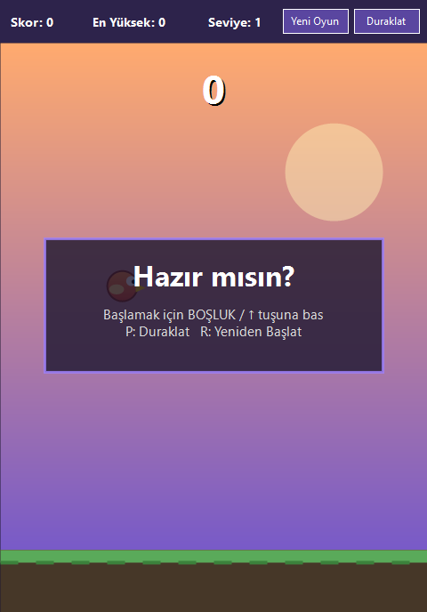
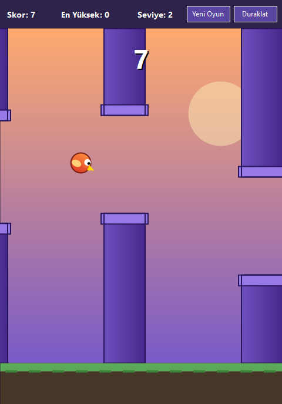
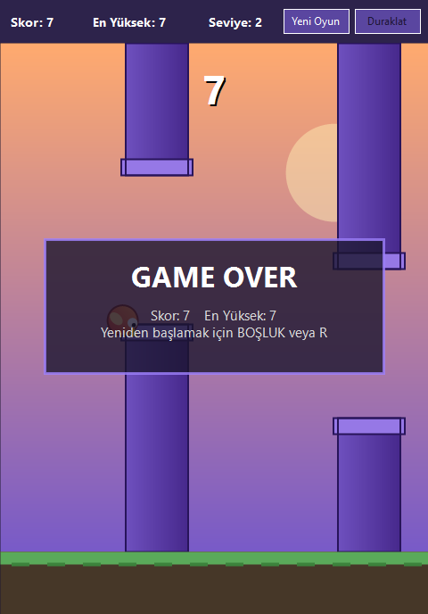

# YMH219 - Kanat Kaçışı (Flappy Bird Benzeri Oyun)

Nesne Tabanlı Programlama (YMH 219) dersi ek uygulama ödevi kapsamında geliştirilmiş, **C# / .NET Windows Forms** ile yazılmış Flappy Bird benzeri bir masaüstü oyunu.
Oyuncu klavye ile kuşu yukarı zıplatır, yer çekimi kuşu aşağı çeker. Sağdan sola gelen sütunların arasından geçtikçe skor artar.

## Ekran Görüntüleri

| Başlangıç | Oyun | Game Over |
|:---:|:---:|:---:|
|  |  |  |

## Kullanılan Teknolojiler

- C# 14 / .NET 10 (`net10.0-windows`)
- Windows Forms (GDI+ ile çizim, `System.Windows.Forms.Timer`)
- Harici NuGet paketi kullanılmamıştır.

## Kurulum ve Çalıştırma

**Visual Studio ile:**
1. Depoyu klonlayın: `git clone https://github.com/Omerdoganse/YMH219-FlappyBird.git`
2. `YMH219-FlappyBird.sln` dosyasını Visual Studio 2022 (17.14+) / 2026 ile açın.
3. `F5` ile çalıştırın.

**Komut satırı ile:**
```bash
cd YMH219-FlappyBird
dotnet run --project FlappyBird
```

> .NET 10 SDK gereklidir: https://dotnet.microsoft.com/download

## Kontroller

| Tuş | İşlev |
|---|---|
| `Boşluk` / `↑` / `W` | Zıpla (oyunu başlatır) |
| `P` / `Esc` | Duraklat / Devam |
| `R` / `Enter` | Yeni oyun |
| **Yeni Oyun** butonu | Oyunu sıfırlar |
| **Duraklat** butonu | Oyunu duraklatır |

## Temel Özellikler

- Kuş klavye ile yukarı zıplar, yer çekimi etkisiyle aşağı düşer (hıza göre dönen kuş çizimi).
- Aynı anda 3 engel sağdan sola hareket eder; ekran dışına çıkan engel rastgele bir boşlukla yeniden konumlandırılır.
- Engel veya zemine çarpınca oyun durur ve **GAME OVER** ekranı gösterilir.
- Her geçilen engel için skor +1.
- **Seviye sistemi:** her 5 puanda seviye artar, hız yükselir ve boşluk daralır.
- **En yüksek skor** `%AppData%\YMH219-FlappyBird\highscore.txt` dosyasında saklanır.
- Duraklat / Devam ve Yeni Oyun işlemleri.
- Çift tamponlu (double buffered) çizim ile titreşimsiz görüntü.

## Proje Yapısı ve Sınıf Tasarımı

```
FlappyBird/
├── Program.cs              # Giriş noktası
├── GameForm.cs             # Ana form: arayüz, klavye olayları, Timer, çizim
├── GameCanvas.cs           # Double buffered çizim paneli
├── Models/
│   ├── GameObject.cs       # Soyut temel sınıf (X, Y, Width, Height, Bounds, Update, Draw)
│   ├── Bird.cs             # Oyuncu: yer çekimi, zıplama, zemin kontrolü
│   └── Obstacle.cs         # Üst/alt sütun çifti: hareket, yeniden konumlanma, çarpışma
└── Game/
    ├── GameState.cs        # Ready / Running / Paused / GameOver
    ├── GameEngine.cs       # Oyun kuralları: skor, seviye, hız, çarpışma, olaylar
    └── HighScoreStore.cs   # En yüksek skoru dosyaya okuma/yazma
```

- **Kalıtım / Çok biçimlilik:** `Bird` ve `Obstacle`, soyut `GameObject` sınıfından türer ve `Update()` / `Draw()` metotlarını override eder.
- **Kapsülleme:** Skor, hız, seviye ve durum bilgileri `GameEngine` içinde `private set` özelliklerle tutulur.
- **Olaylar (event):** `GameEngine`, `ScoreChanged`, `StateChanged` ve `GameEnded` olaylarını yayınlar; form bu olaylarla arayüzü günceller.
- **Hata kontrolü:** Skor dosyası okunamaz/yazılamazsa uygulama çökmez; okuma 0 döner, yazma hatasında kullanıcı uyarılır.

## Bilinen Sınırlamalar / Geliştirme Notları

- Ses efekti bulunmamaktadır.
- `WinForms Timer` çözünürlüğü nedeniyle kare hızı yaklaşık 60 FPS'tir ve sisteme göre küçük farklılık gösterebilir.
- Grafikler resim dosyası yerine GDI+ ile kod içinde çizilmektedir.

## Öğrenci Bilgileri

- **Ad Soyad:** Ömer Doğan
- **Öğrenci No:** 250541101
- **Ders:** Nesne Tabanlı Programlama (YMH 219)
